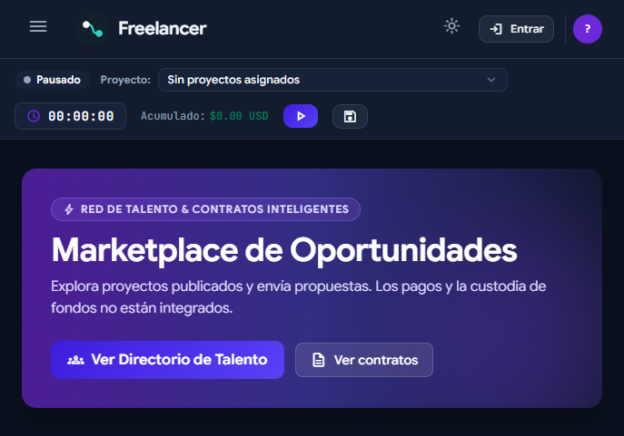

# Entrega para la presentación — Momento 3

## Alcance

En este momento se presenta el **diseño de la plataforma Freelancer**: su interfaz principal y los formularios previstos para clientes y trabajadores. La exposición se concentra en la propuesta visual y el flujo de uso; no se evaluará aquí la operación de los servicios, la conexión a la base de datos ni los pagos.

## Imagen de la aplicación

La captura muestra el marketplace de oportunidades, el acceso a las secciones principales y el control de seguimiento de tiempo.



## Formularios incluidos

La interfaz contiene más de los tres formularios solicitados, sin contar el inicio de sesión:

| Formulario | Para qué sirve | Ubicación |
|---|---|---|
| Registro de usuario | Crear un perfil de cliente o freelancer. | `Frontend/index.html` — modal de registro |
| Publicar proyecto | Describir una oportunidad, seleccionar categoría y definir sus datos. | `Frontend/index.html` — modal de publicación |
| Enviar propuesta | Presentar una tarifa y una carta para un proyecto. | `Frontend/index.html` — modal de postulación |
| Registrar horas manualmente | Ingresar horas, tarifa y descripción de trabajo. | `Frontend/js/views/workspace.js` |

Son formularios HTML adaptables a pantallas pequeñas. Para cubrir la opción híbrida, el proyecto incluye una aplicación Android preparada con **Capacitor**. La interfaz web se ejecuta dentro del WebView nativo de Android; Capacitor conecta esa interfaz con el contenedor y las capacidades del dispositivo. Los formularios se reutilizan como pantallas web, no están reescritos como controles nativos Kotlin.

Para probar la conexión al backend desde el emulador, el Gateway debe estar activo en el computador. El emulador Android usa `http://10.0.2.2:4000`; desde un teléfono físico, se debe establecer `window.FREELANCER_API_BASE` en `Frontend/js/config.js` con la IP local del computador. El HTTP habilitado corresponde únicamente a pruebas locales; una publicación real requiere HTTPS. El proyecto está preparado para Android, pero no se entrega como APK firmado ni publicado en una tienda.

## Demostración en Android

El proyecto Android y la sincronización de recursos Capacitor están preparados. Para abrirlo y ejecutarlo se requiere Android Studio con Android SDK:

```powershell
cd AndroidApp
npm install
npm run android:add   # Solo la primera vez
npm run open:android
```

La configuración fuente se verificó, pero no se pudo compilar ni probar en emulador en este entorno porque no tiene Android Studio ni Android SDK instalados. Si se presenta en un teléfono físico, configura primero la IP local del computador como se indicó arriba.

## Tecnología y justificación

**Tecnología del prototipo:** HTML, CSS y JavaScript para una interfaz web de página única (SPA), adaptable a distintas pantallas, empaquetada como aplicación híbrida Android con Capacitor 8.6.0. La arquitectura existente utiliza Node.js/Express como puerta de entrada y servicios especializados en PHP, Python/FastAPI y Node.js/Express.

Se eligió Capacitor porque permite reutilizar las pantallas y formularios existentes y ejecutarlos en Android dentro de un contenedor nativo, sin mantener una interfaz móvil duplicada. HTML, CSS y JavaScript facilitan iterar el diseño responsive; la arquitectura de servicios separa las responsabilidades de usuarios, proyectos y postulaciones, y seguimiento de tiempo y facturación.

La entrega incluye la configuración fuente de Android con Capacitor. Los servicios backend deben ejecutarse por separado para que funcionen las operaciones con datos. La demostración local utiliza una base nueva y vacía, `plataforma_freelance_demo`; las cuentas y proyectos de prueba se deben crear desde la interfaz. La base anterior permanece intacta. No se afirma que la app sea completamente nativa ni que exista un APK firmado o publicado.

## Presupuesto estimado

Estimación académica para el diseño y preparación de esta entrega, en pesos colombianos (COP). Se toma como referencia una tarifa de **$30.000 COP por hora**; no es una cotización comercial.

| Actividad | Horas | Valor |
|---|---:|---:|
| Definir alcance y recorridos de usuario | 6 | $180.000 |
| Preparar wireframes y guía visual | 12 | $360.000 |
| Diseñar pantallas responsive y formularios | 14 | $420.000 |
| Preparar el contenedor híbrido Android con Capacitor | 8 | $240.000 |
| Revisar, ajustar y preparar la presentación | 6 | $180.000 |
| **Subtotal (46 horas)** | **46** | **$1.380.000** |
| Reserva para imprevistos (10 %) | — | $138.000 |
| **Total estimado** |  | **$1.518.000 COP** |

Se asume el uso de herramientas gratuitas o de código abierto y equipos ya disponibles. La estimación no incluye compra de equipos, alojamiento, dominio, servicios de pago, impuestos, firma de APK ni publicación en tiendas.

## Cronograma estimado

Plan de doce días hábiles:

| Día | Actividad | Resultado |
|---|---|---|
| 1–2 | Acordar alcance, usuarios y recorridos principales. | Requisitos y flujo de navegación |
| 3–4 | Crear wireframes y definir colores, tipografía y componentes. | Guía visual y estructura de pantallas |
| 5–7 | Diseñar marketplace y formularios de registro, publicación y postulación. | Pantallas principales y formularios |
| 8–9 | Revisar adaptación a móvil y escritorio; corregir detalles de legibilidad y navegación. | Diseño responsive revisado |
| 10–11 | Empaquetar la interfaz en Android con Capacitor y validar la apertura en emulador. | Proyecto híbrido Android preparado |
| 12 | Validar la entrega y preparar la sustentación. | Captura, presupuesto, cronograma y presentación |

## Guion breve para la sustentación

> “Para el Momento 3 presento el diseño de Freelancer, una plataforma que conecta clientes con trabajadores independientes. La interfaz incluye formularios para registrarse, publicar proyectos y enviar propuestas. Elegí HTML, CSS y JavaScript para crear la interfaz responsive y Capacitor para empaquetarla como aplicación híbrida Android, reutilizando el mismo código en un WebView nativo. El backend se ejecuta por separado. El presupuesto estimado es de $1.518.000 COP y el cronograma de diseño y preparación es de doce días hábiles.”

## Lista de verificación

- [x] Imagen de la aplicación.
- [x] Más de dos formularios además del login.
- [x] Alcance de diseño delimitado para la presentación.
- [x] Sustentación de la tecnología híbrida (HTML/CSS/JavaScript + Capacitor para Android).
- [x] Presupuesto estimado y cronograma.
